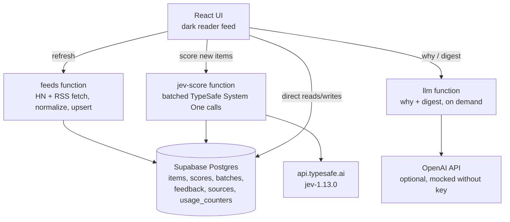

# Cut the Crap

**Jev reads the feed so you don't have to.**

Cut the Crap is a full-stack demo feed reader that pulls Hacker News and RSS items and hides the AI slop, clickbait, and low-signal posts before they ever reach your eyes.

[Jev](https://typesafe.ai) — TypeSafe AI's fast decision model — acts as "System 1": every item gets scored in batches for **signal**, **slop**, **clickbait**, **relevance**, and **type**. Code (not the model) ranks, hides, or blurs items using thresholds you control with sliders. A full LLM ("System 2") only runs on demand: a one-line "why this matters" when you open an item, and a daily digest of the top items.

## Architecture



## Why a fast calibrated scorer beats asking an LLM to rate every item

- **Batched requests.** Jev answers 5 questions about up to 10 items in a single request. One API call replaces ~50 LLM calls.
- **Roughly 100x cheaper per item.** Jev's input price is $0.042/M tokens; a typical LLM judge costs $2.50/M input + $10/M output at ~150 output tokens per item. The Stats panel computes both live so you can see the savings factor.
- **Thresholds stay in code.** The model returns calibrated probabilities; a pure TypeScript `classify()` function decides keep / blur / hide. That logic is unit-testable and instantly adjustable — no re-prompting.
- **The LLM only runs on demand.** Generating prose for every item would be wasteful. Instead, the "why" button and the digest button invoke the LLM exactly when a human wants to read.

## Setup

1. Create a Supabase project and note the URL + anon key.
2. Set secrets:
   ```bash
   supabase secrets set TYPESAFE_API_KEY=... OPENAI_API_KEY=...
   ```
3. Deploy the three edge functions:
   ```bash
   supabase functions deploy feeds
   supabase functions deploy jev-score
   supabase functions deploy llm
   ```
4. Run locally:
   ```bash
   npm install
   npm run dev
   ```

## Environment variables

| Variable | Where | Purpose |
| --- | --- | --- |
| `VITE_SUPABASE_URL` | frontend | Supabase project URL |
| `VITE_SUPABASE_ANON_KEY` | frontend | Supabase anon key |
| `TYPESAFE_API_KEY` | edge function secret | TypeSafe API key for Jev scoring |
| `OPENAI_API_KEY` | edge function secret | LLM for "why" + digest (mocked if absent) |
| `OPENAI_BASE_URL` | edge function secret | Optional; defaults to `https://api.openai.com/v1` |
| `OPENAI_MODEL` | edge function secret | Optional; defaults to `gpt-4o-mini` |
| `DAILY_CALL_LIMIT` | edge function secret | Optional; default 200 calls/day per function |

## Screenshots


## Design decisions

- **Batching 10 items per request.** Jev prices per request, so packing 10 items × 5 questions into one call amortizes overhead. If a batch is rejected for size, it is split in half and retried.
- **Scoring once per item.** Scores live in a table keyed by item, so refreshes only score new arrivals. Existing items keep their scores forever.
- **The daily cap.** `jev-score` and `llm` increment a `usage_counters` row before doing any work; past `DAILY_CALL_LIMIT` (200) they return HTTP 429 and the UI shows a friendly banner and flips to Offline demo mode.
- **Offline demo fallback.** A bundle of 40 hand-written items (solid posts, slop listicles, rage bait, launches) ships inside the `feeds` function. It loads with pre-scored answers, so the full UI is explorable even with zero API access.
